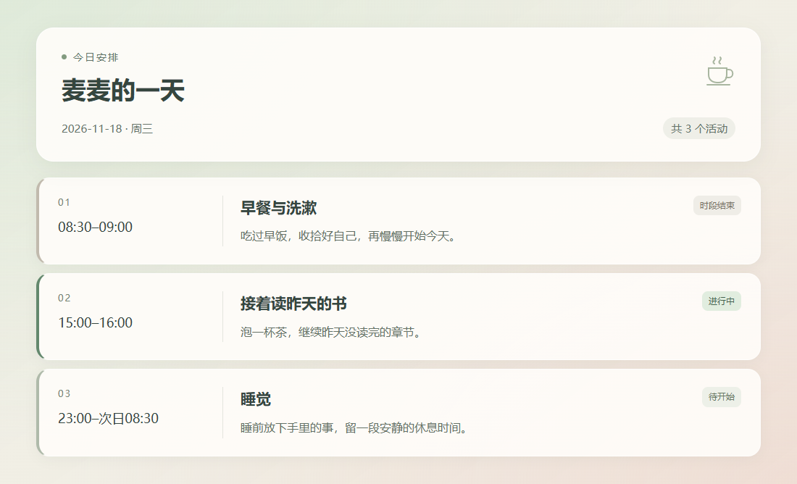

# 麦时迹 (MaiTrace) - 生活与 QQ 空间插件

MaiBot 的生活与 QQ 空间插件：让麦麦拥有每日作息、精力心情、睡眠梦境，并在合适的时候分享近况。

[安装与首次配置](#安装与首次配置) · [常用操作](#常用操作) · [六页配置指南](#六页配置指南) · [常见问题](#常见问题) · [完整参数参考](#完整参数参考) · [跨插件 API](#跨插件-api)

## ✨ 主要特性

### 🗓️ 日程与约定

- **每日作息**：生成每日活动安排，支持跨夜活动和次日策略
- **临时约定**：按人设接受或拒绝约定，检查日期、时长和活动冲突
- **聊天背景**：向 Planner 和 Replyer 提供当前日程与生活背景
- **空档调整**：饥饿、疲惫或有未完成事项时，仅在真实空档补充短活动，不移动已有约定
- **主动聊天与提醒**：在允许的会话中分享话题、提醒约定，并按活动调节聊天频率

### 🌙 生活与陪伴

- **生活状态**：持续推进精力、饥饿、口渴、身体疲劳、困意、洗漱需要、心情与睡眠，支持不适恢复及可选角色月经周期
- **活动结果与接续**：区分自身模拟经历和用户陈述，共同约定等待确认；记录未完成事项供之后继续
- **麦生活接入**：可直接读取 Mai_life 的状态和场景，空档中也保留生活背景
- **场景与梦境**：细化当前活动场景，醒来后生成私人梦境
- **私人日记**：整理自身生活，支持主人在本人私聊中阅读
- **重要日期与主动私聊**：记录生日等日期，根据用户许可选择联系时机
- **本地历法**：提供节假日、农历和节气；旧聊天日记仍可阅读

### 🌐 QQ 空间与配图

- **主题发帖**：按主题生成说说，也可直接发布指定私聊的最新正文
- **空间互动**：浏览、点赞、评论、回复及回忆曾参与的空间活动
- **自动分享**：根据当前日程、生活素材、静默时段和冷却决定是否发帖或浏览
- **可选配图**：调用[麦麦绘卷](https://github.com/1021143806/mais_art_journal)生成自拍或普通图片，也可使用表情包
- **跨插件接口**：提供空间发布、日程、生活状态、场景和历法等公开 API

## 安装与首次配置

### 安装插件

在 **MaiBot 根目录**（包含 `plugins` 的目录）执行：

```shell
git clone https://github.com/Yae-Miko-Rabbit/MaiTrace.git plugins/MaiTrace
```

启动或重启 MaiBot，打开 WebUI 的 MaiTrace 配置页。

<details>
<summary>运行要求与手动安装依赖</summary>

需要 Python 3.12+、MaiBot 1.3.11+ 和插件 SDK `>=2.15.0,<3`；Python 版本还需符合所用 MaiBot 的要求。主程序负责安装 Python 依赖。

需要手动安装时，Windows 下在 MaiBot 根目录执行：

```powershell
uv pip install --python .venv/Scripts/python.exe -r plugins/MaiTrace/requirements.txt
```

使用其他虚拟环境或系统时，将 `--python` 后的路径换成 MaiBot 实际使用的 Python。

</details>

### 首次配置，三步开始

1. **添加管理员。** 在“开始使用 → 先填这两项”开启插件，填写自己的管理员 QQ。
2. **确认生活来源。** 在“每日生活”将“日程提供方”和“生活状态由谁提供”保持为 `internal`（MaiTrace 内置），按需要调整每天生成日程的时间。
3. **保存并查看。** 初次只使用日程和生活时，先在“QQ 空间”关闭“自动发说说”和“自动刷空间”。保存并重载插件，然后用 `/zn plan status` 查看日程；缺少时用 `/zn plan generate` 补生成。

基础人设读取主程序。内置日程和生活可独立使用；[麦生活](https://github.com/octmicy/Mai_life)、QQ 空间登录和[麦麦绘卷](https://github.com/1021143806/mais_art_journal)分别用于外部生活来源、空间功能和 AI 配图。

<details>
<summary>新安装时的默认设置</summary>

下表列出新安装时的默认值；升级保留已填写的设置。

| 功能 | 默认状态 | 使用前需要知道 |
| --- | --- | --- |
| 日程与生活状态 | 开启，来源为内置 | 每天 00:30 检查并生成缺少的今日日程，已有日程继续使用 |
| 自动发说说、自动刷空间 | 开启 | 执行需要空间登录及当前活动；自动发帖还需要可公开生活素材。检查一次不代表执行一次 |
| 生活主动私聊、生活消息处理 | 关闭 | 需要分别开启功能，并添加允许联系的用户 |
| 日程主动聊天与约定提醒 | 开关开启，聊天名单为空 | 初始不运行；需要填写允许日程主动联系的聊天 |
| 说说配图、聊天内容参考、角色月经周期 | 关闭 | 按需要单独启用 |
| 管理员 QQ、生活联系人、发说说权限名单 | 空 | 命令、私人日记访问和自然聊天发布需要分别配置 |

</details>

## 功能预览

<p align="center">
  
</p>

<p align="center"><sub>使用示例活动展示日程卡片，节选三个时段。背景、位置和卡片不透明度可自行设置。</sub></p>

## 常用操作

| 想做什么 | 命令 |
| --- | --- |
| 查看帮助 | `/zn help` |
| 查看文字日程 | `/zn plan status` |
| 查看日程图片 | `/zn plan list` |
| 补生成今日安排 | `/zn plan generate` |
| 查看生活状态 | `/zn status` |
| 发布主题说说 | `/zn <主题>` |

命令权限见[权限与联系人](#权限与联系人)。在自然聊天中也可以问“今天有什么安排？”或提出“明天 18 点一起吃饭”，模型会根据需要调用工具。

<details>
<summary>完整命令与用法</summary>

权限条件见[权限与联系人](#权限与联系人)。

#### 空间发布与帮助

| 命令 | 说明 |
| --- | --- |
| `/zn help`、`/zn plan help`、`/zn debug help` | 查看对应帮助 |
| `/zn <主题>` | 生成并发布说说 |
| `/zn custom` | 发布 `send.custom_qqaccount` 指定私聊的最新正文 |

#### 日程与约定

| 命令 | 说明 |
| --- | --- |
| `/zn plan status`、`/zn plan list` | 查看作息文本或图片 |
| `/zn plan generate`、`/zn plan regenerate [要求]` | 补生成或重新生成今日作息 |
| `/zn plan update <请求>` | 添加约定，如“明天18:00一起吃饭” |
| `/zn plan delete <ID或序号>`、`/zn plan clear [天数]` | 删除活动或清理旧作息 |

#### 生活与重要日期

| 命令 | 说明 |
| --- | --- |
| `/zn status`、`/zn life` | 查看生活状态与场景 |
| `/zn life recent`、`/zn life 经历` | 查看自身结果和当前会话的待确认、待接续事项 |
| `/zn life diary` | 阅读私人生活日记 |
| `/zn dates list`、`/zn dates add YYYY-MM-DD <名称>` | 查看或添加本人重要日期 |
| `/zn dates confirm <ID>`、`/zn dates delete <ID>` | 确认候选或删除手动日期 |
| `/zn ls`、`/zn v [日期] [编号]` | 阅读旧聊天日记 |

#### 运行状态与排查

| 命令 | 说明 |
| --- | --- |
| `/zn config` | 查看生活、消息、主动私聊和历法的开关状态 |
| `/zn debug cookie`、`/zn debug routine` | 检查登录与自动行为 |

当日约定只插入空档，冲突会给出可选时间；未来约定不限制天数。其他会话只看到占用时段，具体约定仅向提出约定的会话展示。

旧聊天日记日期支持 `YYYY-MM-DD`、`YYYY/MM/DD`、`YYYY.MM.DD`、今天、昨天、前天，`/zn <日期>` 等价于 `/zn v <日期>`。`/zn life diary` 需在主人私聊使用；`/zn dates` 需在本人私聊使用，并启用对应用户档案。`/zn plan clear [天数]` 的参数表示保留天数，默认 0，保留今天及仍在持续的跨夜活动。

</details>

<details>
<summary>自然聊天工具</summary>

模型可在自然聊天中调用以下工具；例如“发一条关于晚霞的说说”“看看某某最近的空间”“明天18点一起吃饭”。是否调用由主程序模型决定。

| Tool | 用途 | 权限与范围 |
| --- | --- | --- |
| `send_feed` | 根据主题生成正文、配图并发布 | `send.permission`，默认空白名单禁用 |
| `read_feed` | 读取指定好友动态并按配置点赞、评论 | `read.permission`，默认空黑名单允许真实 QQ 调用者 |
| `recall_qzone_activity` | 按关键词回忆自己发布、评论和回复过的内容 | 共用 `read.permission`，返回条数默认 10，范围 1–50 |
| `get_planning_status_v6` | 查询今天的作息，缺少时可补生成 | 日程开关及 `schedule.allowed_streams` |
| `generate_schedule_v6` | 生成今日作息，已有日程时直接返回 | 日程开关及 `schedule.allowed_streams` |
| `update_schedule_v6` | 按人设接受或拒绝约定，检查日期、时长及冲突 | 日程开关及 `schedule.allowed_streams` |
| `query_life_experiences` | 查询活动记录 ID、来源、结果及未完成事项 | 生活和结果开关、真实调用者及 `schedule.allowed_streams`；私人记录限当前会话 |
| `record_life_outcome` | 按用户明确陈述保存完成或未完成结果 | 同上；核对当前调用者近 30 分钟的消息原话，用户陈述不覆盖公开模拟经历 |

</details>

<details>
<summary>对话示例</summary>

#### 主题说说

```text
用户：/zn 今天的晚霞
麦麦：[根据主题生成并发布说说，按配置添加图片]
```

#### 日程查询与约定

```text
用户：麦麦，今天有什么安排？
麦麦：[查询今日作息]

用户：/zn plan update 明天18:00一起吃饭
麦麦：[按人设判断是否接受，并检查活动冲突]
```

#### 私人日记与重要日期

在已启用用户档案的本人私聊中使用；私人日记还需要主人角色，命令均需管理员权限。

```text
用户：/zn life diary
麦麦：[展示私人生活日记]

用户：/zn dates add 2000-11-10 生日
麦麦：[记录本人重要日期]
```

</details>

## 六页配置指南

先完成首次配置，再按需要展开对应页面。下面使用界面中的中文名称；原字段、默认值和完整条件见[参数参考](#完整参数参考)。

<details>
<summary><strong>开始使用</strong> · 管理员与角色设定</summary>

- 在“先填这两项”开启插件，添加管理员 QQ。
- 基础人设读取主程序；有额外设定时，展开“角色与说话风格（可选）”，填写“补充角色身份和外观”。
- 保存配置后重载插件。也可编辑插件目录的 `config.toml`。

</details>

<details>
<summary><strong>每日生活</strong> · 日程、身体状态与日记</summary>

- 在“每天怎么安排生活”确认“启用日程”和“日程提供方”，调整“每天自动生成日程”及生成时间；额外要求填写在“日程内容（可选）”。
- 在“生活状态与日记”确认“启用生活状态”，按需要开启场景、梦境和日记。“跨日内容重复检查”默认开启；“空闲时补充必要的生活活动”根据身体需要或未完成事项补充短活动。
- 月经周期默认关闭，需要时展开“角色月经周期（可选）”并填写基准日期。接入麦生活时，日程提供方选择 `maibot-community.mai-life`；同时读取其状态，还需在“生活状态与日记 → 生活状态由谁提供”选择同一值。

</details>

<details>
<summary><strong>主动私聊</strong> · 联系人、休息回复与提醒</summary>

- 在“联系人与重要日期”添加联系人，填写 QQ 号、身份和主动联系许可。
- 生活主动私聊需要同时开启“启用生活私聊与消息追踪”“允许主动发起生活私聊”，以及该联系人的“允许主动私聊”。再设置间隔和免打扰时段，并确认已有真实私聊会话。
- “生活私聊休息回复闸门”按需开启。“约定提醒与日程主动聊天（可选）”使用独立的聊天名单和开关。

</details>

<details>
<summary><strong>日程图片</strong> · 自定义背景</summary>

1. 在 MaiTrace 插件目录创建 `images` 文件夹，放入自己的图片，例如 `background.jpg`。
2. 在“日程图片背景”将“背景图片路径”填写为 `images/background.jpg`；“背景适配方式”选 `cover`（铺满，会裁切）或 `contain`（完整显示，可能留白）。
3. 按需要选择背景位置，“卡片不透明度”建议先用 `0.9`。保存并重载后执行 `/zn plan list`，无需重新生成日程。

示例图片需要自行准备，仓库不包含个人背景、登录缓存或个人 `config.toml`。路径留空使用默认底色，填写无效路径会报错。

</details>

<details>
<summary><strong>QQ 空间</strong> · 登录、分享与配图</summary>

- 展开“QQ 空间登录”设置登录方式，完成后用 `/zn 今天的晚霞` 测试发布。需要自然聊天发帖时，在“通过聊天发说说”配置权限；需要自动分享时，再开启“自动发说说”或“自动刷空间”。
- 在“说说配图（可选）”开启“发说说时附带图片”。AI 配图选择 `only_ai` 并填写绘卷实际配置的模型编号，如 `model3`；表情包选择 `only_emoji`，无需绘卷。
- QQ 官方机器人的聊天登录不提供空间 Cookie。空间功能需要另行连接已登录真实 QQ 的 SnowLuma/NapCat，或让空间服务解析到真实 QQ 号并扫码登录。

| 适配器 | 发布方式 |
| --- | --- |
| SnowLuma | 直接调用空间 API，支持文字和多图 |
| NapCat | 获取 Cookie 后发布 |
| QQ 官方机器人 | 需额外连接 SnowLuma/NapCat，或提供真实 QQ 号并扫码登录空间 |

默认启用适配器、OneBot HTTP、本机 QQ、扫码和缓存五种登录方式。自动方式会按近期成功情况调整顺序，扫码和缓存排在末尾。OneBot HTTP 默认 `127.0.0.1:9999`，认证填写 `plugin.http_token`。登录问题可用 `/zn debug cookie` 排查。

QQ 官方机器人的聊天登录与空间登录分别配置。空间发布账号需是能解析到的真实 QQ 号，AppID 或 OpenID 不能代替；只使用内置日程和生活时无需配置空间登录。

</details>

<details>
<summary><strong>高级设置</strong> · 模型、聊天参考与维护</summary>

- 模型任务使用主程序已有配置，如 `replyer`、`utils`。场景、梦境、日记与日程生成会调用模型。
- “空间和生活模型”中的“单次模型超时（秒）”控制空间和生活请求；日程模型、生成轮数和等待时间在“日程模型与生成改进”单独设置。
- 提前考虑明日安排、聊天参考、缓存、日志和清理通常保持默认。分页、折叠和说明随插件提供；下拉选项保留原值，并附中文说明。

</details>

#### 权限与联系人

<details>
<summary>管理员、主人、空间权限与主动联系</summary>

| 想使用的功能 | 需要配置的权限 | 补充条件 |
| --- | --- | --- |
| 使用所有 `/zn` 命令 | 开始使用 → 管理员 QQ（`plugin.admin_qq`） | 日程命令还受日程会话范围及额外管理员设置限制 |
| 用 `/zn life diary` 阅读私人日记 | 管理员 QQ + 联系人身份 `owner` | 启用联系人，并在主人本人的私聊使用 |
| 自然聊天请求发说说 | QQ 空间 → 通过聊天发说说中的权限名单（`send.permission`） | 默认白名单为空，需添加调用者 QQ；空间已登录 |
| 自然聊天请求查看空间 | QQ 空间 → 手动查看与评论中的权限（`read.permission`） | 默认空黑名单允许真实 QQ 调用者；空间已登录 |
| 生活主动私聊 | 生活和消息开关 + 联系人的主动许可 | 已有私聊会话，通过精力、冷却、免打扰和发送次数检查 |
| 约定提醒、日程主动聊天 | 允许日程主动联系的聊天（`schedule.proactive_streams`）及对应开关 | 需使用内置日程；每项填写已有聊天，如 `qq:private:123456789` |

权限分别配置。填写主人身份后，仍需设置管理员 QQ 才能使用私人日记命令；允许主动联系也不会授权空间发布。主动任务交给 MaiBot 判断是否发送，满足设置后也可能保持安静。

</details>

## 常见问题

<details>
<summary>命令提示未配置管理员，或主人看不了日记</summary>

命令授权与私人日记阅读条件见[权限与联系人](#权限与联系人)。日程命令还需检查“允许使用日程的聊天”和额外日程管理员设置。

</details>

<details>
<summary>用官方机器人适配器，可以使用这些功能吗</summary>

日程和生活功能无需 QQ 空间登录。QQ 官方机器人的聊天登录不提供 QQ 空间 Cookie；需要空间功能时，额外连接已登录真实 QQ 的 SnowLuma/NapCat，或让空间服务解析到真实 QQ 号并扫码登录。AppID 和 OpenID 不能作为空间发布账号的 QQ 号。用 `/zn debug cookie` 检查当前账号与登录状态。

</details>

<details>
<summary>为什么日程里还是会重复出现一些活动</summary>

吃饭、睡觉、洗漱、工作习惯和有进展的持续项目可以重复。“跨日内容重复检查”默认参考最近 3 天，检查主要活动是否机械重复，具体语义判断由模型完成。该设置影响后续生成；需要立即调整已保存日程时，用 `/zn plan regenerate [要求]` 重新生成。参考天数和生成改进设置见参数参考。

</details>

<details>
<summary>跨夜日程如何显示，第二天会不会丢失</summary>

例如晚上 23:00 睡到第二天 08:30，文字和图片显示为 `23:00–次日08:30`。凌晨可承接昨日仍在持续的活动，身体状态随时间继续推进。聊天中的时间不需要手动换成超过 24 点的写法。

</details>

<details>
<summary>自定义背景为什么没显示，或提示图片读取失败</summary>

确认图片已放到插件目录，路径与文件名一致，例如 `images/background.jpg`；保存后重载插件，再用 `/zn plan list` 查看。只下载插件不会获得示例背景。路径留空使用默认底色，填写无效路径会报错；支持 PNG、JPEG、WebP，文件不超过 10 MiB、2000 万像素。横图被裁切较多时，可改用竖图或 `contain`。

</details>

<details>
<summary>自动发帖或浏览一直没有动作</summary>

用 `/zn plan status` 确认当前活动，`/zn debug cookie` 检查空间登录，`/zn debug routine` 查看冷却、免打扰、禁止活动、模型拒绝或概率跳过。自动发帖还需要生活公开素材；开启开关不代表每轮都发布。

</details>

<details>
<summary>主动私聊或约定提醒为什么没发送</summary>

生活私聊需要启用生活、消息和主动私聊开关，联系人启用主动许可，并已有真实私聊会话。约定提醒还需将目标聊天加入 `schedule.proactive_streams`。主动任务提交后仍由 MaiBot 判断是否发送，可用 `/zn config` 查看开关状态。

</details>

<details>
<summary>AI 配图失败怎么办</summary>

检查绘卷已启用，模型编号与绘卷配置一致，自拍参考图有效。“AI 图片失败时停止发布”开启时，缺少必须的 AI 图片会停止发布。日程背景是本地图片设置，与 AI 配图分别配置。

</details>

<details>
<summary>下拉框为什么显示 internal、cover 这样的英文值</summary>

这些是配置文件使用的原值，旁边的字段说明给出中文含义。分页、折叠和说明随 MaiTrace 提供；更新插件后重载，并刷新配置页面。

</details>

## 完整参数参考

按功能归为六类。下面保留原配置段和全部字段；部分配置段的字段在 WebUI 中分布于不同页面。

<details>
<summary><strong>开始使用 · 基础与人设</strong></summary>

#### 插件开关与管理员（`[plugin]`）

| 字段 | 默认值 | 说明 |
| --- | --- | --- |
| `enabled` | `true` | 插件总开关，关闭后停止日程、生活、空间和消息服务 |
| `admin_qq` | `[]` | `/zn` 管理员 QQ 字符串列表；留空禁用全部命令，与 Tool 权限及主人角色独立 |

#### 角色设定（`[persona]`）

| 配置段 | 字段 | 默认值 | 说明 |
| --- | --- | --- | --- |
| `persona` | `self_description` | `""` | 补充身份和外观，作为空间、生活和日程模型的背景；留空时读取已启用绘卷的 `selfie.prompt_prefix` |
| `persona` | `use_multiple_reply_style` | `true` | 按主程序 `personality.multiple_probability` 从 `multiple_reply_style` 抽样；关闭或风格池为空时使用 `reply_style` |

</details>

<details>
<summary><strong>每日生活 · 日程、身体状态与日记</strong></summary>

#### 日程开关、范围与生成时机（`[schedule]`）

| 字段 | 默认值 | 说明 |
| --- | --- | --- |
| `enabled` | `true` | 日程总开关，控制所选提供方的读取与注入；内置模式还控制生成、约定和日程主动服务 |
| `provider` | `"internal"` | 日程提供方；可选 `"maibot-community.mai-life"`，读取麦生活现有公开 API，日程生成、修改与维护由麦生活负责 |
| `allowed_streams` | `[]` | 日程注入、命令、会话 Tool 及生成聊天历史的会话白名单；空列表或 `"all"` 允许全部，不授权主动消息 |
| `admin_users` | `[]` | `/zn plan` 的额外管理员限制；非空时调用者必须同时属于此名单和 `plugin.admin_qq` |
| `timezone` | `"Asia/Shanghai"` | 日程、生活、空间提示词、静默窗口和每日额度共用的 IANA 时区 |
| `auto_schedule_enabled` / `auto_schedule_time` | `true` / `"00:30"` | 每天到点生成当天缺少的日程；已有日程则跳过，启动时已过点也会检查，不主动发聊天消息 |
| `auto_generate` | `true` | 仅内置模式：日程查询 Tool 查询今天且无日程时补生成；与定时生成开关独立 |
| `cross_day_activity` | `true` | 允许 `23:00-01:30` 等跨夜活动，凌晨可承接昨日活动 |
| `custom_prompt` | `""` | 生成日程时的额外要求，例如“多安排运动，晚上留出空档”；普通文本，不使用模板占位符 |
| `adaptive_enabled` | `true` | 仅内置日程：在真实空档安排补水、进餐、洗漱、小睡、休息或接续自身未完成事项；不移动已有活动和约定 |
| `adaptive_interval_minutes` | `60` | 两次空档调整的最短间隔，范围 10–1440 分钟，重启后继续沿用 |

跨夜活动在文字日程、日程图片和生成摘要中标注“次日”，例如 `23:00–次日08:30`。内部仍保存连续分钟数（如 `[1380, 1950]`），供跨夜查询、冲突检查和身体状态结算；无需重新生成已有日程。

#### 日程提供方

选择麦生活提供日程时，在 WebUI 的“每日生活 → 每天怎么安排生活 → 日程提供方”选择 `maibot-community.mai-life`，或在 `[schedule]` 设置 `provider = "maibot-community.mai-life"`；麦生活需安装并启用在同一 MaiBot 实例中。默认 `provider = "internal"`，配置重载后重建所选来源。

麦生活模式不启动 MaiTrace 内置日程数据库、定时生成、约定提醒和日程频率调节；原有内置记录保留，切回内置后继续使用。日程查询 Tool、`/zn plan status`、`/zn plan list`、公开日程 API、Planner/Replyer 注入、生活推进和空间活动背景统一读取麦生活日程。`/zn plan` 的生成、修改、删除、清理及相应 Tool 提示使用麦生活对应功能，不操作内置记录。

外部日程在后台刷新，聊天 Hook 只读内存。提供方未就绪或查询失败时明确报告失败并自动重试，不切回内置、不补造日程。空日程和缺失历史保持为空。外部时间戳归一到 MaiTrace 的 `schedule.timezone`，生成时机仍由麦生活自己的配置控制。其余内置生成、裁判和日程主动设置只在内置模式生效；MaiTrace 生活层和空间功能仍使用自己的配置。

如同时接入麦生活状态，在“每日生活 → 生活状态与日记 → 生活状态由谁提供”选择同一提供方。对应配置：

```toml
[schedule]
provider = "maibot-community.mai-life"

[life]
provider = "maibot-community.mai-life"
```

两个来源均默认为 `internal`。使用麦生活状态时，日程来源必须也选择麦生活；MaiTrace 只读取其 `get_life_state` 和 `get_current_scene`，不再次推进数值、生成活动场景、修改日程或唤醒。状态无效、超过一小时未更新或接口失败时清除可用状态并报告错误，后台自动重试。仅选择外部日程、生活保留内置的原有模式仍可使用。

#### 生活状态与私人日记（`[life]`）

| 字段 | 默认值 | 说明 |
| --- | --- | --- |
| `enabled` | `true` | 生活状态、场景、梦境、私人日记、日期和生活主动私聊的总开关，也为自动空间发帖提供公开素材 |
| `provider` | `"internal"` | 生活状态来源，可选 `"maibot-community.mai-life"`；外部状态需同时选择麦生活日程 |
| `outcomes_enabled` | `true` | 记录活动结果及接续事项；关闭后保留历史，停止整理、查询和注入结果 |
| `tick_seconds` | `60` | 生活素材、日期与清理的巡检间隔，单位秒，范围 10–3600；生活数值约每 30 秒推进 |
| `offline_hours` | `72` | 离线后最多回放已有日程的小时数，范围 1–72；未保存的活动不会补造 |
| `initial_energy` / `initial_hunger` | `70` / `20` | 首次建库的精力与饥饿，范围 0–100，饥饿越大越饿；修改不会覆盖已有状态 |
| `scene_enabled` / `dream_enabled` | `true` / `true` | 根据已有活动细化场景、醒来后生成私人梦境；关闭后历史保留 |
| `diary_enabled` / `diary_hour` | `true` / `8` | 每天从指定整点开始整理昨天的私人生活日记，整点范围 0–23；有素材时每天一篇 |
| `profiles` / `important_dates` | `[]` / `[]` | 用户许可档案和重要日期数组，子字段及示例见下文；空档案没有私人日记读者，也不主动私聊 |
| `private_proactive_enabled` | `false` | 生活主动私聊总开关，还需 `messaging.enabled`、用户许可和真实私聊会话 |
| `private_min_interval_minutes` | `180` | 同用户两次生活主动私聊成功发送的最短间隔，单位分钟，范围 10–10080 |
| `private_silence_minutes` | `15` | 联系前距用户最近真实消息的最短时间，单位分钟，范围 0–1440；0 不要求等待 |
| `private_min_energy` | `30` | 主动私聊所需最低精力，范围 0–100；入睡、浅睡、深睡时仍跳过 |
| `private_pending_seconds` | `300` | 交给 Planner 的主动任务有效期，单位秒，范围 30–1800；过期未发送可释放素材 |
| `claim_lease_seconds` | `1800` | 素材认领租约，单位秒，范围 30–7200；自动空间发布按实际发布预算延长 |
| `opportunity_retention_days` | `30` | 已到期且未占用素材的额外保留天数，范围 1–365；私人日记、梦境及结果待核对素材保留 |

生活日记整理自身场景、梦境和匿名互动数量，保存在本地；旧版抓取聊天并发布日记的功能已停止，旧文件仍可通过 `/zn ls` 和 `/zn v` 阅读。

内置生活状态会跨天保留口渴、身体疲劳、困意、洗漱需要和不适。运动、学习、家务、休息与睡眠有不同负荷；休息能缓解身体疲劳，睡眠进一步缓解困意。不适由持续饥饿、口渴、低精力、疲劳、困意及已启用的经期状态产生，诱因缓解后逐步恢复，不凭空生成病名或靠一次休息瞬间痊愈。这是角色生活模拟，不是真实健康监测。

身体需求只由时间和已保存的活动推进：进餐、喝水和洗漱在活动结束时结算一次，重启不重复结算；没有记录的空档不推断已经喝水或睡觉。短时喝水可以合并到其他起居活动，使用 `parameters.care_actions = ["drink"]`，洗漱用 `["wash"]`。内置生成和聊天背景会读取当前身体状态，缺少外部字段时不编造补充状态。

今日日程先考虑身体需要、已接受约定和有记录依据的生活责任，再用剩余时间安排兴趣。洗衣、收拾、采购等依据近期完成情况安排，没有新需要就不重复做；不设每天固定数量的家务，也不编造职业、学校、家人或账单。生成仍由模型决定，具体自然度需要结合实际生成结果观察。

#### 角色月经周期（`[life_menstrual]`）

只在 `life.provider = "internal"` 时生效，默认关闭；不根据性别或聊天内容自动启用。需要明确填写一次经期首日作为基准，按日程时区计算经期、经后过渡恢复、平常阶段和经前阶段，跨天、离线和重启不重新开始。周期按配置长度近似模拟，并非真实人的经期预测。

| 字段 | 默认值 | 说明 |
| --- | --- | --- |
| `enabled` | `false` | 适用角色显式启用；开启时必须提供起始日期 |
| `last_period_start` | `""` | 一次已知经期首日，严格 `YYYY-MM-DD`；未来日期之前显示等待 |
| `cycle_days` / `period_days` | `28` / `5` | 模拟周期与经期长度，分别 21–40 天和 2–8 天 |
| `symptom_level` | `30` | 模拟不适峰值 0–100；0 表示无明显不适，不强制痛经或情绪低落 |

```toml
[life_menstrual]
enabled = true
last_period_start = "2026-11-18" # 示例日期，请改成角色设定中的基准日期
cycle_days = 28
period_days = 5
symptom_level = 30
```

WebUI 中使用独立的“角色月经周期”配置区，五个参数分别编辑。旧 `[life.menstrual]` 自动迁移到 `[life_menstrual]`，保留开关、基准日期、周期长度和不适程度；新旧配置同时存在时，新字段优先。

不适程度影响休息和活动负荷；没有明显不适也可以正常生活，不强制整日卧床。经期和洗漱本身不作为自动公开分享的理由，聊天也不需要反复提及身体细节。使用 `/zn life` 可查看当前身体状态和启用后的周期阶段。

#### 本地历法（`[environment]`）

| 配置段 | 字段 | 默认值 | 说明 |
| --- | --- | --- | --- |
| `environment` | `calendar_enabled` | `true` | 启用中国节假日、农历与节气，需要生活服务和历法依赖；关闭后仍提供配置时区的日期时间 |

</details>

<details>
<summary><strong>主动私聊 · 联系人、日期与提醒</strong></summary>

#### 用户许可与主人（`[[life.profiles]]`）

| 字段 | 默认值 | 说明 |
| --- | --- | --- |
| `user_id` | `""` | 用户真实 QQ 字符串，添加档案时必须填写，不可重复 |
| `enabled` | `true` | 启用该用户的生活私聊观察和访问许可，关闭后保留历史 |
| `role` | `"friend"` | `owner` 可在本人私聊读私人日记等主人内容；`friend` 可访问自己的日期和公开生活，最多启用一位主人 |
| `proactive_enabled` | `false` | 允许生活服务主动联系此用户，还需生活和消息总开关 |
| `daily_proactive_max` | `1` | 每天生活主动私聊成功发送次数上限，范围 0–20；0 禁用，按实际发送成功计数 |
| `quiet_start` / `quiet_end` | `"23:00"` / `"08:00"` | 此用户生活主动私聊静默时段，支持跨夜；起止相同表示不设静默，不限制普通被动聊天 |

启用主人及主动私聊的示例：

```toml
[life]
private_proactive_enabled = true

[[life.profiles]]
user_id = "123456789"
enabled = true
role = "owner"
proactive_enabled = true
daily_proactive_max = 1
quiet_start = "23:00"
quiet_end = "08:00"

[messaging]
enabled = true # 修改后重载插件，注册生活消息处理
```

主人角色不授权命令，使用 `/zn life diary` 仍需加入 `plugin.admin_qq`，并在主人本人私聊中调用。朋友可增加独立的 `[[life.profiles]]`，设置 `role="friend"`。主动任务交给 MaiBot 判断是否发送，满足开关和额度并不保证立即联系。

#### 重要日期（`[[life.important_dates]]`）

| 字段 | 默认值 | 说明 |
| --- | --- | --- |
| `user_id` | `""` | 所属用户 QQ，必须匹配 `life.profiles` 中的档案 |
| `name` / `date` | `""` / `""` | 名称与有效公历日期 `YYYY-MM-DD`，添加条目时均必填，名称最多 100 字 |
| `yearly` | `true` | 是否每年按月日重复，`false` 为一次性日期；2 月 29 日只在有效闰年出现 |
| `lead_days` | `[7, 1, 0]` | 提前生成提醒素材的天数，每项 0–366，0 为当天，空列表禁用提醒素材 |

```toml
[[life.important_dates]]
user_id = "123456789" # 需先配置这个用户的 life.profiles
name = "生日"
date = "2000-11-10"
yearly = true
lead_days = [7, 1, 0]
```

日期只生成提醒素材，发送仍需用户启用主动私聊并通过静默、冷却和额度检查。聊天识别的日期是候选，需要本人用 `/zn dates confirm <ID>` 确认后才进入提醒；配置中的日期请在 WebUI 或配置文件修改。

#### 生活消息处理（`[messaging]`）

| 字段 | 默认值 | 说明 |
| --- | --- | --- |
| `enabled` | `false` | 注册生活消息接收、发送前后处理；日期观察、生活主动回执依赖此项，修改后必须重载插件 |
| `turn_expire_seconds` | `300` | 源消息关联、撤回定位和回复轮次标识的保留秒数，范围 30–1800 |
| `recall_enabled` | `true` | 源消息撤回时取消对应尚未发送的回复，已发送消息保留；作用于群聊追踪和已配置的生活私聊 |
| `rest_gate_enabled` | `false` | 根据睡眠/休息状态判断已启用档案的私聊是否回复，需启用生活；群聊由主程序决策，命令直接放行 |
| `wake_probability` | `0.1` | 休息闸门开启时，普通私聊允许唤醒回复的概率，范围 0–1；明确唤醒可通过，明确勿扰优先拒绝 |
| `awake_grace_minutes` | `20` | 休息中实际回复成功后的继续聊天宽限，单位分钟，范围 1–120；明确勿扰仍优先 |

消息逐条处理。`turn_expire_seconds` 与生活主动任务有效期仅用于追踪和过期管理，不会延迟、等待或合并消息。

#### 日程主动聊天、约定提醒与聊天频率（`[schedule]`）

| 字段 | 默认值 | 说明 |
| --- | --- | --- |
| `proactive_streams` | `[]` | 主动任务、约定提醒和频率调节的会话名单；空列表完全禁用这三项，必须显式填写已有会话，不支持 `"all"` |
| `enable_proactive_trigger` | `true` | 对已确认、有目标会话的约定，在开始后前 5 分钟尝试提交提醒；同一约定每天每会话最多一次 |
| `activity_proactive_enabled` | `true` | 合适的活动生成自然话题并交给 MaiBot Planner；工作、学习、睡眠等场景跳过，Planner 可以不发送 |
| `activity_proactive_cooldown_minutes` | `180` | 每会话普通主动任务的最短提交间隔，单位分钟，范围 10–10080 |
| `activity_proactive_daily_max` | `2` | 每会话每天最多提交的普通任务数，范围 0–20；0 禁用，按提交计数，同一活动最多一次 |
| `activity_proactive_quiet_start` / `activity_proactive_quiet_end` | `"23:00"` / `"08:00"` | 普通日程主动任务静默时段，支持跨夜；起止相同表示不设静默 |
| `enable_frequency_modulation` | `true` | 按活动调整名单会话的聊天频率，睡眠约 0.05、工作/学习约 0.3，休息/娱乐提高；关闭或卸载后恢复 |

约定提醒需要目标会话在 `proactive_streams` 中，但不受普通日程主动聊天的冷却、每日额度和静默限制。生活主动私聊使用独立许可；由生活私聊负责的会话会避免重复提交普通日程任务。

会话填写示例，QQ 号与群号请替换为实际值；对应聊天流需已在主程序中存在：

```toml
[schedule]
allowed_streams = ["qq:group:987654321", "qq:private:123456789"]
proactive_streams = ["qq:private:123456789"] # 只允许在该私聊主动聊天、提醒和调节频率
auto_schedule_time = "00:30"
custom_prompt = "下午安排运动，晚饭后留一些机动空档。"
```

也支持 `session:真实会话ID` 和旧裸会话 ID；其他平台可将 `qq` 替换为对应平台标识。日程是麦麦的一条全局时间线；其他会话只能看到约定占用的时段，具体内容仅向提出约定的会话展示。

</details>

<details>
<summary><strong>日程图片 · 背景与卡片</strong></summary>

#### 日程背景与卡片（`[schedule_image]`）

`/zn plan list` 使用浅色茶会卡片：时间、活动和状态分别呈现，内置日程的序号继续用于删除活动；当前时段与尚未开始的活动分别标记，时段结束不会冒充结果已经完成。内置和麦生活日程共用此版式。

```toml
[schedule_image]
background_path = "images/background.jpg" # 先将自己的图片放到插件的 images 文件夹
background_fit = "cover"
background_position = "top"
card_opacity = 0.90
```

| 字段 | 默认值 | 说明 |
| --- | --- | --- |
| `background_path` | `""` | 本地 PNG/JPEG/WebP 图片；相对路径基于 MaiTrace 插件目录，也可填绝对路径。留空使用柔和渐变底色 |
| `background_fit` | `"cover"` | `cover` 铺满并裁切，`contain` 完整显示；不拉伸、不重复 |
| `background_position` | `"top"` | 垂直位置：`top`、`center` 或 `bottom`，水平保持居中 |
| `card_opacity` | `0.90` | 卡片不透明度，范围 0.6–1；越高文字越清楚，越低越能看见背景 |

WebUI 中使用独立的“日程图片”配置区，背景路径、适配方式、位置和不透明度分别编辑。旧 `[schedule.image]` 配置自动迁移到 `[schedule_image]`，保留原背景和参数；新旧设置同时存在时优先保留新设置，避免覆盖 WebUI 编辑。

推荐使用竖版背景；日程越长，`cover` 对横图的裁切越明显。Windows 绝对路径可写为 `background_path = 'G:\图片\茶会背景.jpg'`，单引号中无需转义反斜杠。背景只取首帧并纠正照片方向，最大 10 MiB、2000 万像素，嵌入前缩小至最长边 2048 像素。图片读取和处理在工作线程中完成，渲染不联网；显式填写的路径不存在或图片无效时报告错误，不忽略设置继续发送。设置保存后重载插件，再用 `/zn plan list` 查看，无需重新生成日程。

</details>

<details>
<summary><strong>QQ 空间 · 登录、说说与互动</strong></summary>

#### QQ 空间登录（`[plugin]`）

| 字段 | 默认值 | 说明 |
| --- | --- | --- |
| `adapter_priority` | `[]` | 适配器探测优先级，填写完整插件 ID 或后缀，如 `snowluma-adapter`；留空自动探测 |
| `cookie_methods` | `["adapter", "napcat", "clientkey", "qrcode", "local"]` | Cookie 获取方式；前几项按近期成功率重排，扫码和缓存在末尾。空列表使用默认全部方式，刷新失败仍尝试缓存 |
| `http_host` / `http_port` | `"127.0.0.1"` / `"9999"` | `napcat` Cookie 方式使用的 OneBot HTTP 地址；主机不带协议、端口或路径，端口是 1–65535 的数字字符串 |
| `http_token` | `""` | OneBot HTTP 认证 Token，未设置认证时留空；适配器 API 获取与 SnowLuma 直发不使用这些 HTTP 设置 |

#### 发说说与聊天素材（`[send]`）

| 字段 | 默认值 | 说明 |
| --- | --- | --- |
| `permission` / `permission_type` | `[]` / `"whitelist"` | `send_feed` Tool 的调用者 QQ 权限；白名单只允许名单内用户，黑名单只拒绝名单内用户 |
| `prompt` | 内置说说模板 | 生成正文的提示词，支持 `{current_time}`、`{bot_personality}`、`{bot_expression}`、`{topic}`、`{current_activity}` |
| `history_number` | `5` | 参考近期说说数以避免重复，0 完全关闭历史查询 |
| `custom_qqaccount` | `""` | `/zn custom` 读取的私聊对象 QQ，留空禁用；直接发布最新一条筛选后的非命令正文，仍可配图 |
| `custom_only_mai` | `true` | Custom 模式只取麦麦发言；`false` 只取对方发言，Custom 跳过正文模型、历史参考和素材整理 |

#### 可选聊天素材

| 字段 | 默认值 | 说明 |
| --- | --- | --- |
| `enable_chat_memory` | `false` | 在主题正文生成时使用所选聊天作为匿名背景 |
| `filter_mode` / `target_chats` | `"whitelist"` / `[]` | `all` 全部、`whitelist` 仅名单、`blacklist` 排除名单；空白名单不读取任何聊天，空黑名单与 `all` 相同 |
| `include_private_chat_memory` | `false` | 允许把所选私聊用作匿名背景；关闭时所有过滤模式均排除私聊 |
| `time_range` / `last_hours` | `"today"` / `6` | `today` 读取配置时区的当天消息；`last_n_hours` 读取最近 1–72 小时，由 `last_hours` 指定 |
| `min_messages` / `max_messages` | `5` / `50` | 有效消息门槛与最近消息上限，分别为 1–100、1–200，最小值不得大于最大值；上限作用于每会话查询及合并结果 |
| `per_message_max_chars` | `200` | 单条素材字符上限，范围 20–2000；隐藏号码、邮箱和发送者标识 |
| `chat_memory_mode` | `"hybrid"` | `direct` 使用匿名片段，`summary` 全部摘要，`hybrid` 摘要早期消息并保留近期片段 |
| `summary_model` | `"utils"` | 摘要使用的主程序任务名，超时沿用 `llm.llm_timeout_seconds`；`direct` 模式忽略 |
| `summary_prompt` | 内置匿名摘要模板 | 仅支持 `{chat_logs}` 占位符，用于 `summary` / `hybrid` |
| `hybrid_recent_count` | `10` | Hybrid 保留的最近片段数，范围 1–100；全部消息均属近期片段时不调用摘要模型 |
| `fallback_prompt` | `"今天的聊天比较平淡，只根据当前生活和主题自然表达。"` | 无选中会话或消息不足时追加的背景；网络、查询或模型错误仍报告失败 |

素材会话格式为 `group:群号`、`private:QQ号` 或 `session:真实会话ID`，与日程的 `qq:group:群号` 写法不同。例如只选一个群的近期聊天：

```toml
[send]
enable_chat_memory = true
filter_mode = "whitelist"
target_chats = ["group:987654321"]
include_private_chat_memory = false
time_range = "last_n_hours"
last_hours = 6
chat_memory_mode = "hybrid"
summary_model = "utils"
```

素材只用于匿名背景，公开正文不得包含聊天原话、身份和私人安排。修改模板时，字面花括号写作 `{{` 和 `}}`；空间正文、摘要、评论与回复模板只接受各自声明的占位符。

#### AI / 表情包配图（`[image]`）

| 字段 | 默认值 | 说明 |
| --- | --- | --- |
| `enable_image` | `false` | 主题和自动发帖的配图总开关，关闭时发布纯文字 |
| `image_mode` | `"random"` | `only_ai` 仅 AI、`only_emoji` 仅表情包、`random` 按概率选一种来源；本条多张图片共用来源 |
| `ai_probability` | `0.5` | Random 模式下本次发布选择 AI 的概率，范围 0–1 |
| `image_number` | `1` | 每条期望配图数，范围 1–4，AI 逐张串行生成；修改后重载插件 |
| `pic_plugin_model` | `""` | 绘卷 `models.<key>` 中的 key，如 `model3`；AI 配图需安装并配置绘卷 |
| `require_image` | `true` | AI 图片必须全部成功才发布；设为 `false` 可缺图继续。表情包未匹配时允许无图 |
| `image_retry` | `2` | 每张 AI 图失败后的额外重试数，范围 0–2，每次间隔 5 秒；修改后重载插件 |
| `ai_content_mode` | `"random"` | 每张 AI 图各以 50% 概率选自拍/普通画图；`selfie` 固定自拍，`illustration` 固定普通画图，重试保持原选择 |
| `selfie_style` | `"photo"` | 自拍视角：`standard` 前置、`mirror` 对镜、`photo` 第三人称、`auto` 按活动选择；普通画图忽略 |
| `clear_image` | `true` | `true` 不新增 AI 图片本地副本；`false` 归档到 SDK 数据目录 `images/`，已有历史图片保留 |

固定使用绘卷自拍的示例，`model3` 请替换为绘卷中实际配置的模型 key：

```toml
[image]
enable_image = true
image_mode = "only_ai"
pic_plugin_model = "model3"
image_number = 1
ai_content_mode = "selfie"
selfie_style = "auto"
require_image = true
image_retry = 2
```

自拍使用绘卷的角色设定和参考图，并同步活动、衣着、地点、时段及细化场景；普通画图只使用本次内容。每次绘卷调用预算为 185 秒，默认一张图最多尝试 3 次；空间发布本身不会自动重发。

#### 读取动态与手动互动（`[read]`）

| 字段 | 默认值 | 说明 |
| --- | --- | --- |
| `permission` / `permission_type` | `[]` / `"blacklist"` | `read_feed` 与 `recall_qzone_activity` Tool 的调用者 QQ 权限；默认允许所有有真实 QQ 身份的调用者 |
| `read_number` | `5` | `read_feed` 单次读取好友动态数，至少 1，建议 3–10；修改后重载插件，不控制自动浏览条数 |
| `like_probability` / `comment_probability` | `1.0` / `1.0` | 手动读取对未处理动态尝试点赞/评论的概率，范围 0–1；自动浏览使用 `monitor` 的概率 |
| `allow_skip_comment` | `true` | 手动读取和自动浏览时允许模型输出“不回复”跳过新说说评论；仍按概率点赞并记入去重，不控制评论区和链式回复 |
| `prompt` / `rt_prompt` | 内置评论模板 | 普通动态/转发动态的评论模板，手动与自动共用 |

普通评论模板支持 `{current_time}`、`{bot_personality}`、`{bot_expression}`、`{target_name}`、`{created_time}`、`{content}`、`{impression}`；转发评论另支持 `{rt_con}`。概率为 1 表示每条尝试，模型仍可跳过评论，接口也可能失败。

`read_feed` 工具支持 `enable_comment=false`（或“不回复”）明确关闭本次评论，不生成评论正文；点赞与动态去重仍按配置执行。

#### 自动浏览、点赞与回复（`[monitor]`）

自动浏览由 `[routine]` 驱动，作者范围、互动概率和去重由本段控制。

| 字段 | 默认值 | 说明 |
| --- | --- | --- |
| `read_list` / `read_list_type` | `[]` / `"blacklist"` | 说说作者 QQ 名单；空黑名单处理全部，空白名单不处理任何人，自己的评论区也受此限制 |
| `like_probability` / `comment_probability` | `1.0` / `1.0` | 对未处理好友动态尝试点赞/评论的概率，范围 0–1；评论共用 `read` 模板及跳过设置 |
| `silent_hours` | `"22:00-07:00"` | 自动互动静默时段，支持跨夜和半角逗号分隔多段；端点包含在内，留空全天可互动 |
| `like_during_silent` / `comment_during_silent` | `false` / `false` | 静默期是否允许点赞、评论及回复；Routine 默认先拦截整轮，见下文静默说明 |
| `enable_auto_reply` / `self_read_number` | `false` / `5` | 是否检查自己最近动态并回复新评论；条数至少 1，关闭后不查询自己的评论区 |
| `reply_prompt` | 内置评论区回复模板 | 支持 `{current_time}`、`{bot_personality}`、`{bot_expression}`、`{nickname}`、`{created_time}`、`{content}`、`{comment_content}`、`{impression}` |
| `reply_to_reply_prompt` | 内置链式回复模板 | 回复好友空间中对麦麦评论的回复，独立于 `enable_auto_reply`；占位符将上行的 `{comment_content}` 替换为 `{bot_comment}`、`{reply_content}` |
| `processed_feeds_cache_size` | `100` | 手动读取与自动浏览共用的已处理动态 ID 上限，至少 1，持久化去重；淘汰的旧动态可能再次互动 |
| `processed_comments_cache_size` | `100` | 自动回复去重记录上限，至少 1，按说说 ID 分组计数，同一说说可保存多条已回复评论 ID |

使用作者白名单并开启自己评论区回复时，`read_list` 中也要允许麦麦自己的 QQ。好友动态评论概率不控制自己评论区及链式回复；这两类回复仍受作者名单和静默评论许可约束。

#### 日程驱动的自动空间行为（`[routine]`）

| 字段 | 默认值 | 说明 |
| --- | --- | --- |
| `post_enabled` / `browse_enabled` | `true` / `true` | 自动发帖/浏览开关，均需要日程和当前活动；自动发帖还需要生活及可公开素材 |
| `check_interval_minutes` | `20` | 两轮自动决策的检查间隔，单位分钟，至少 1 |
| `post_cooldown_minutes` / `browse_cooldown_minutes` | `120` / `40` | 自动发帖/浏览冷却，单位分钟，至少 1；手动命令和 Tool/API 不受此冷却限制 |
| `respect_silent_hours` | `true` | 在 `monitor.silent_hours` 内跳过发帖/浏览整轮决策；关闭后浏览内部仍检查静默互动许可 |
| `post_blocked_activities` / `browse_blocked_activities` | `["sleeping", "working", "studying", "eating", "exercising"]` | 发帖/浏览禁止活动类型，命中后不调模型；空列表关闭对应硬限制 |
| `max_post_chance` / `max_browse_chance` | `1.0` / `1.0` | 模型允许之后再次通过的概率，范围 0–1；0 禁用对应行为，1 保留模型判断和其他条件 |
| `require_reason` | `true` | 模型给出是/否及理由，可在 `/zn debug routine` 查看；关闭后只要求是/否 |

Routine 先检查冷却、静默和活动类型，再由模型判断是否适合发帖或浏览，最后按概率决定。默认使用 MaiTrace 内置日程，也可读取麦生活日程；即使概率设置为 1，也不会每轮必定发帖。

#### 与麦麦绘卷配合

[麦麦绘卷](https://github.com/1021143806/mais_art_journal)为 MaiTrace 生成自拍或普通配图；MaiTrace 则提供当前日程、生活状态和空间直发接口，供绘卷的主动图片功能使用。

需要空间配图时，在绘卷中配置生图模型，再按上方 `[image]` 说明启用配图并填写模型 key。自拍的角色设定与参考图由绘卷管理，活动、衣着、地点和场景由 MaiTrace 提供。

</details>

<details>
<summary><strong>高级设置 · 模型、聊天参考与维护</strong></summary>

#### 空间和生活模型（`[llm]`）

| 配置段 | 字段 | 默认值 | 说明 |
| --- | --- | --- | --- |
| `llm` | `text_model` | `"replyer"` | 空间正文、评论、Routine 决策和生活生成使用的主程序模型任务名 |
| `llm` | `llm_timeout_seconds` | `90` | 空间、生活及素材摘要的单次模型超时，单位秒，范围 10–600；修改后重载插件 |
| `llm` | `show_prompt` | `false` | 在 INFO 日志打印空间正文、评论和回复的完整提示词；日程归档使用单独的开关 |

模型字段填写主程序配置中的任务名，如 `replyer`、`utils`；AI 配图的 `image.pic_plugin_model` 则填写绘卷模型 key。文本外观描述和自拍形象分别配置，自拍的角色设定、参考图仍由绘卷管理。

#### 日程生成质量、背景与日志（`[schedule]`）

| 字段 | 默认值 | 说明 |
| --- | --- | --- |
| `llm_task_name` | `"replyer"` | 日程生成、约定裁判、次日策略推断和普通日程主动话题使用的主程序任务名 |
| `generation_timeout` | `180.0` | 单次日程模型超时，单位秒，至少 10；普通日程主动话题最多等待 60 秒。修改后重载插件 |
| `max_tokens` | `8192` | 单轮日程生成的最大输出 token 数，至少 1000 |
| `use_multi_round` / `max_rounds` | `true` / `2` | 质量不足时再次生成，最多 1–5 轮，包含首轮；关闭多轮后只生成一次。修改后重载插件 |
| `quality_threshold` | `0.85` | 多轮生成提前停止分数，范围 0–1；最终结果仍需通过结构、冲突及启用的跨日重复检查 |
| `min_activities` / `max_activities` | `8` / `15` | 单日活动数量上下限，均至少 1，最小值不能大于最大值 |
| `enable_detailed_description` | `true` | 生成并展示活动详细描述；关闭后以活动名称呈现，已有描述保留 |
| `min_description_length` / `max_description_length` | `20` / `50` | 详细描述的字符数上下限，均至少 5，最小值不能大于最大值 |
| `recent_schedule_days` | `3` | 生成时参考最近日程的天数，范围 1–14，用于场景连续和主题去重 |
| `repetition_check_enabled` | `true` | 内置生成比较近期主要活动，相似组合调用日程模型做语义复核；机械重复反馈重试，起居、习惯和合理接续保留 |
| `history_message_limit` | `30` | 当天聊天背景总条数上限，按 `allowed_streams` 允许的 QQ 会话分摊；0 禁用，与 `send.enable_chat_memory` 独立 |
| `knowledge_search_limit` | `5` | 可选知识库检索条数；0 禁用，知识检索不可用时仍继续生成 |
| `cache_ttl` | `300` | 日程快照及注入优化历史有效期，单位秒，至少 10；后台会刷新，生活状态仍持续推进 |
| `llm_log_enabled` / `llm_log_retention_days` | `true` / `7` | 日程生成和裁判日志保存到 SDK 数据目录 `schedule/llm_logs/`，默认保留 7 天；关闭归档后仍清理旧日志 |

跨日检查使用已有日程记录，默认回看最近 3 天。先比较主要活动的内容、题材和类型组合，再对相似安排做语义复核，检查是否只是换名字、改时间或改写句子。进餐、睡眠、洗漱、补水、休息、通勤不参与判重，私人约定和已取消记录也不参与比较。只有一个主要爱好重复出现时不作为整天模板重复处理。

复核结合人设、近期进度、身体状态、明确要求和生活事务判断：固定工作、上课、熟悉习惯以及有具体进展的项目允许延续，不要求每天换兴趣或制造事件。判定机械重复的候选不会作为“最佳结果”保存，多轮模式在原有 `max_rounds` 内反馈重试；所有候选都失败时报告原因，重生成时保留旧日程。关闭多轮后仍会检查，但不额外生成第二份。

相似候选每轮最多增加一次日程模型复核，复用现有 `llm_task_name` 和 `generation_timeout`；相关调用归档为 `schedule_repetition_review`，外层命令与 Tool 的时间预算包含复核。最终语义判断仍依赖模型，不能保证识别所有细微重复。已保存的今天日程继续使用，需立即重新生成可执行 `/zn plan regenerate`。

#### 次日策略与约定判断（`[schedule]`）

| 字段 | 默认值 | 说明 |
| --- | --- | --- |
| `auto_infer_next_day_prompt` / `infer_time` | `false` / `"22:30"` | 前夜推断次日额外要求，只保存策略，供次日定时生成使用；与定时生成开关独立 |
| `infer_lookback_days` | `3` | 次日推断参考历史天数，范围 1–7，与 `recent_schedule_days` 独立 |
| `infer_max_prompt_chars` | `300` | 次日策略最多字符数，至少 50 |
| `infer_use_completion_signal` | `true` | 推断时参考活动状态和进度，仅开启次日推断时生效 |
| `role_judge_enabled` / `role_judge_temperature` | `true` / `0.3` | 更新约定时按人设判断接受或拒绝，温度范围 0–2；关闭裁判后仍检查日期、时长和冲突 |

#### 日程与生活背景注入（`[inject]`）

先通过 `[schedule]` 的 `inject_schedule=true` 允许 Planner 背景注入、`inject_into_replyer=true` 允许 Replyer 背景注入；两个开关独立，均默认为 `true`。`max_future_activities=3` 控制注入时展示的未来活动条数，0 不展示，不限制查询工具返回的完整日程。

当前没有活动或日程关闭时，仍可按相同会话范围和注入策略提供精力、心情、睡眠及最近活动结果，不补造正在做的事。技术问答和命令仍跳过背景，重试保留同轮内容；私人结果只出现在已核验的对应私聊。

熟悉的习惯和持续项目可以重复，变化依据已有进度、身体状态和约定产生。内置日程不要求每天添加特色；场景和结果生成参考近期自身记录，减少反复使用相同细节。平淡生活可以不分享，聊天中已说过且没有新进展的背景不反复介绍。

| 字段 | 默认值 | 说明 |
| --- | --- | --- |
| `enable_intent_classification` | `true` | 区分日程问询、闲聊、技术问答和命令，技术/命令场景跳过；关闭后按闲聊处理 |
| `enable_state_analysis` | `true` | 补充活动阶段和已进行时间，生活精力、饥饿和心情仍由生活引擎推进 |
| `enable_inject_optimization` | `true` | 控制重复注入与闲聊概率；关闭后仍保留会话范围、意图分类、同轮承接及重试保护 |
| `casual_chat_inject_probability` | `0.5` | 优化开启时非连续闲聊的注入概率，范围 0–1；直接问日程、持续话题和 Replyer 承接不受此概率限制 |
| `context_max_turns` / `context_ttl` | `3` / `600` | 每会话注入记录保留轮数及有效秒数，分别至少 1 和 60；用于话题延续判断 |

#### 旧日程清理（`[goal_cleanup]`）

| 配置段 | 字段 | 默认值 | 说明 |
| --- | --- | --- | --- |
| `goal_cleanup` | `cleanup_interval` | `3600` | 后台清理间隔，单位秒，至少 60；启动时也执行一次，处理到期作息、旧作息和日程模型日志 |
| `goal_cleanup` | `cleanup_old_goals_days` | `30` | 已完成/取消的旧生活作息保留天数，至少 1；无时段旧目标及约定历史保留 |

#### 配置版本（`[plugin]`）

| 字段 | 默认值 | 说明 |
| --- | --- | --- |
| `config_version` | `"6.7.4"` | 插件维护的配置模板版本，请勿手动修改 |

#### 静默与自动行为

全部时间使用 `schedule.timezone`，默认 `Asia/Shanghai`。

| 行为 | 静默设置 | 默认时段 |
| --- | --- | --- |
| 自动空间发帖/浏览 | `monitor.silent_hours`，Routine 默认遵守 | 22:00–07:00 |
| 普通日程主动聊天 | `schedule.activity_proactive_quiet_start/end` | 23:00–08:00 |
| 生活主动私聊 | `life.profiles[].quiet_start/end` | 23:00–08:00 |

`routine.respect_silent_hours=false` 后，自动浏览仍受 `monitor` 的静默点赞/评论许可限制。手动命令、Tool 和 API 不受上述自动静默限制；约定提醒不受普通日程主动静默限制。

权限设置见[权限与联系人](#权限与联系人)；跨插件 API 的触发权限由调用方负责。

</details>

## 跨插件 API

供绘卷等插件查询生活背景或调用空间功能。

<details>
<summary>接口列表与 SDK 调用示例</summary>

命名空间为 `Rabbit-Jia-Er.MaiTrace`，以下均为公开接口，通过 SDK `ctx.call_capability("api.call", ...)` 调用。调用方负责触发权限，接口不使用空间 Tool 的 QQ 名单。

| API | 用途 |
| --- | --- |
| `publish_topic_api(topic, ...)` | 生成文图并发布 |
| `send_feed_api(message, images=[])` | 发布自备文图，图片为无 data URL 前缀的 base64 |
| `get_feeds_list_api(target_qq, num=5, filter=False)` | 读取指定 QQ 的动态，`filter=True` 过滤已评论动态；只返回列表，不执行点赞或评论 |
| `get_current_activity()` | 当前活动 |
| `get_schedule(day="")` | 指定公历日期 `YYYY-MM-DD` 的日程，留空为今天 |
| `get_life_state()` | 生活状态 |
| `get_current_scene()` | 当前场景 |
| `get_environment_snapshot()` | 本地历法 |
| `create_proactive_opportunity(topic, ...)` | 创建分享契机，可传 `motive`、`privacy`、`expires_minutes`、`source_key`；默认私密，有效期 120 分钟，由调度器决定是否使用 |

### 生成并发布主题说说

生成正文和配图后发布；`current_activity`、`activity_type`、`outfit` 为可选活动背景，`topic="custom"` 使用 Custom 直发模式：

```python
result = await self.ctx.call_capability(
    "api.call", timeout_ms=1_230_000,
    api_name="Rabbit-Jia-Er.MaiTrace.publish_topic_api", version="1",
    args={"topic": "今天的晚霞", "current_activity": "散步"},
)
# 成功返回 {"result": True, "story": "说说正文", "message": "状态说明"}
```

### 发布自备文图

发布调用方准备好的正文和图片，图片为无 `data:image/...` 前缀的 base64 字符串，纯文字可省略 `images`。此接口直接发布，不调用配图服务，也不受 `image.require_image` 限制：

```python
result = await self.ctx.call_capability(
    "api.call", timeout_ms=185_000,
    api_name="Rabbit-Jia-Er.MaiTrace.send_feed_api", version="1",
    args={"message": "今天也过得很充实。", "images": []},
)
```

### 读取动态列表

```python
result = await self.ctx.call_capability(
    "api.call", timeout_ms=65_000,
    api_name="Rabbit-Jia-Er.MaiTrace.get_feeds_list_api", version="1",
    args={"target_qq": "123456789", "num": 5, "filter": False},
)
# 成功返回 {"result": True, "message": "状态说明", "data": [...]}
```

前三个空间 API 以 `result` 布尔字段表示结果。发布返回 `uncertain=True` 时，表示可能已经发出，应先核对空间；无效 base64 图片会阻止直发。活动、生活和历法接口返回对应快照，`get_schedule` 返回活动列表，公开接口隐藏私人约定详情。

默认配置下，`send_feed_api` 调用预算建议 185 秒，`publish_topic_api` 建议 1230 秒；图片数量、重试、模型超时变化后，重载插件并按实际组件预算调整调用方超时。

</details>

## 升级说明

升级后重载即可，旧配置和数据自动迁移并保留原件。数据默认位于 `data/plugins/Rabbit-Jia-Er.MaiTrace/`；无需清空数据库。

配置修改建议重载，尤其是消息开关、图片数量/重试、模型超时和日程生成轮数。初始精力/饥饿只用于首次建库；生成参数只影响后续日程。

## ⚠️ 注意事项

- 所有 `/zn` 命令均需 `plugin.admin_qq` 授权；主人角色、空间 Tool 权限和管理员权限分别配置。
- 主动任务交给 MaiBot 判断是否发送，满足开关和额度并不保证立即联系。
- 发布结果为 `uncertain=true` 时先核对空间，避免重复发布。

## 贡献和反馈

- **制作者水平有限，任何漏洞、疑问或建议,欢迎提交 [Issue](https://github.com/Yae-Miko-Rabbit/MaiTrace/issues) 或 Pull Request！**
- **作者QQ：3082618311或群1025591815（部分请求可能被过滤导致回复不及时，请见谅）**
- **其余问题请联系作者修复或解决**

---

## 🤝 致谢

- 感谢 [MaiBot](https://github.com/MaiM-with-u/MaiBot)，以及 [xc94188](https://github.com/xc94188)、[myxxr](https://github.com/myxxr)、[UnCLAS-Prommer](https://github.com/UnCLAS-Prommer)、[XXXxx7258](https://github.com/XXXxx7258)、[heitiehu-beep](https://github.com/heitiehu-beep) 提供的功能改进。

## 🔗 版权信息

- 作者：Yae-Miko-Rabbit
- 许可证：[AGPL-3.0-only](LICENSE)
- 原有和引用组件的许可保留于 [LICENSES/](LICENSES/)
- 项目主页：https://github.com/Yae-Miko-Rabbit/MaiTrace
